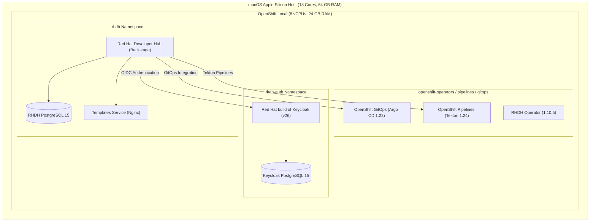

# Red Hat Developer Hub (RHDH) Local Environment

This repository provides an automated, declarative setup for running **Red Hat Developer Hub (RHDH)** locally on macOS (Apple Silicon or Intel) powered by **OpenShift Local (CRC)** and Red Hat Operators.

---

## 🏗️ Architecture Overview



---

## 🌐 Endpoints & Credentials

| Service | Endpoint | Credentials / Details |
| :--- | :--- | :--- |
| **Red Hat Developer Hub** | [`https://backstage-rhdh-rhdh.apps-crc.testing`](https://backstage-rhdh-rhdh.apps-crc.testing) | Log in via Keycloak OIDC |
| **Keycloak SSO Console** | [`https://rhdh-keycloak-rhdh-auth.apps-crc.testing`](https://rhdh-keycloak-rhdh-auth.apps-crc.testing) | **Admin:** `admin` / `adminpassword123!`<br>**Realm:** `redhat-developer-hub` |
| **OpenShift Web Console** | [`https://console-openshift-console.apps-crc.testing`](https://console-openshift-console.apps-crc.testing) | `kubeadmin` / `5H7NJ-imEAe-ECjP4-YTnKA` |
| **OpenShift API Server** | [`https://api.crc.testing:6443`](https://api.crc.testing:6443) | `oc login -u kubeadmin -p 5H7NJ-imEAe-ECjP4-YTnKA` |
| **Argo CD UI** | [`https://openshift-gitops-server-openshift-gitops.apps-crc.testing`](https://openshift-gitops-server-openshift-gitops.apps-crc.testing) | **Username:** `admin`<br>**Password:** stored in secret `openshift-gitops-cluster` |
| **Templates Service** | `http://rhdh-templates.rhdh.svc:8080` | Internal Service / OpenShift Route |

### 👤 Pre-Configured Test Users (Keycloak OIDC)

When accessing Red Hat Developer Hub, you can sign in with either of the following users:

| Username | Password | Role / Description |
| :--- | :--- | :--- |
| `developer` | `developer123!` | Standard developer account (`Dev User`) |
| `platform-admin` | `admin123!` | Platform administrator account (`Admin User`) |

---

## 🚀 Quick Start Guide

### Prerequisites
1. **Hardware:** macOS laptop with at least 32 GB RAM (64 GB recommended) and 8+ CPU cores.
2. **Red Hat Pull Secret:** Placed in the project root as `pull-secret.json` (already configured in `.gitignore`).

### 1. Start OpenShift Local (CRC)
```bash
./scripts/01-setup-crc.sh
```
*Allocates 8 vCPUs and 24 GB RAM, sets the pull secret, and starts the CRC virtual machine.*

### 2. Deploy the Entire Stack
```bash
./scripts/deploy-all.sh
```
This automated orchestrator runs the modular deployment sequence:
- `scripts/02-deploy-operators.sh`: Subscribes to Pipelines (Tekton), GitOps (Argo CD), Keycloak (RHBK), and Developer Hub (RHDH) Operators.
- `scripts/03-deploy-keycloak.sh`: Deploys PostgreSQL 15, initializes Keycloak v26 with Edge TLS, and imports the `redhat-developer-hub` Realm.
- `scripts/04-deploy-rhdh.sh`: Configures RHDH PostgreSQL, deploys the local Golden Path template server, applies secrets/dynamic plugins, and spins up the Backstage instance.

---

## 📦 Dynamic Plugins Configured in RHDH

The following dynamic plugins are enabled in [`manifests/04-rhdh/02-dynamic-plugins.yaml`](manifests/04-rhdh/02-dynamic-plugins.yaml):

- **OpenShift Topology:** (`backstage-community-plugin-topology`) — Visual topology view of OpenShift deployments, pods, and routes.
- **Kubernetes Integration:** (`backstage-plugin-kubernetes` & `backstage-plugin-kubernetes-backend-dynamic`) — Cluster resource status and pod metrics via `rhdh-sa`.
- **Role-Based Access Control (RBAC):** (`backstage-community-plugin-rbac`) — Permission and role policies.
- **Kubernetes Scaffolder Module:** (`backstage-community-plugin-scaffolder-backend-module-kubernetes-dynamic`) — Scaffolder actions to interact with Kubernetes objects.
- **Adoption Insights & Extensions:** Pre-bundled Red Hat portal insights.

*(Note: `techdocs` is disabled by default to prevent heavy compilation delays under binary emulation).*

---

## 🛠️ How to Use the Golden Path Template

A production-ready **Quarkus Cloud-Native Microservice** Golden Path template is pre-packaged and registered in the RHDH catalog.

### What the Template Generates
- **Java 21 Quarkus 3.x REST API**: Complete Maven project (`pom.xml`, `GreetingResource.java`, `application.properties`, OpenAPI/Swagger UI endpoints).
- **Tekton CI Pipeline**: Automated Git clone, Maven test, and fast-jar container compilation pipeline (`pipeline.yaml`).
- **Argo CD Application**: GitOps deployment manifest with automated synchronization and namespace creation (`application.yaml`).
- **Backstage Catalog Entity**: `catalog-info.yaml` with plugin annotations linking Tekton, Argo CD, and OpenShift Topology.

### Step-by-Step Usage:
1. Open [`https://backstage-rhdh-rhdh.apps-crc.testing`](https://backstage-rhdh-rhdh.apps-crc.testing) in your browser.
2. Sign in using Keycloak OIDC credentials (`developer` / `developer123!`).
3. In the left-hand navigation sidebar, click **Create...**.
4. Select the **Quarkus Cloud-Native Microservice** card and click **Choose**.
5. Provide your microservice configuration:
   - **Service Name:** (e.g., `payment-service`)
   - **Description:** A short description of the service
   - **Owner:** `dev-team`
   - **Target Namespace:** OpenShift namespace to deploy to (default: `rhdh-apps`)
   - **Repository Location:** Your GitHub organization / repository (e.g., `github.com/my-org/payment-service`)
6. Click **Next** and **Create**.
7. The Scaffolder executes:
   - Generates the codebase with all templates interpolated.
   - Pushes the repository directly to your Git host.
   - Automatically registers the new component in the RHDH Software Catalog.
   - Connects OpenShift Pipelines (Tekton) and OpenShift GitOps (Argo CD) for automatic CI/CD.

---

## 📁 Repository Structure

```text
├── README.md                          # This guide
├── pull-secret.json                   # Red Hat registry pull secret (ignored in git)
├── scripts/
│   ├── common.sh                      # Cluster environment variables and Kubeconfig locator
│   ├── 01-setup-crc.sh                # CRC VM setup, resources, and startup
│   ├── 02-deploy-operators.sh         # Installs Pipelines, GitOps, Keycloak, RHDH Operators
│   ├── 03-deploy-keycloak.sh          # Deploys Keycloak DB, Keycloak instance & realm
│   ├── 04-deploy-rhdh.sh              # Deploys PostgreSQL, Secrets, RHDH & Templates server
│   └── deploy-all.sh                  # One-command full stack orchestrator
├── manifests/
│   ├── 01-operators/                  # Subscriptions for Red Hat Operators
│   ├── 02-keycloak/                   # Keycloak DB, Keycloak CR, Route, and Realm import
│   ├── 03-postgresql/                 # Dedicated PostgreSQL 15 for RHDH
│   ├── 04-rhdh/                       # AppConfig, Dynamic Plugins, Backstage CR, and Catalog Users
│   └── 05-templates/                  # In-cluster Nginx server hosting Golden Path templates & org users
└── templates/
    └── golden-paths/
        └── quarkus-service/           # Quarkus Golden Path template and skeleton code
            ├── template.yaml          # Backstage Scaffolder Template spec
            └── skeleton/              # Quarkus REST service, Tekton pipeline & ArgoCD app
```

---

## 💡 Technical Notes & Design Decisions

- **Why OpenShift Local instead of Podman Compose?**
  Tekton and Argo CD are Kubernetes-native engines relying on CRDs (`Pipeline`, `PipelineRun`, `Application`), API servers, and controllers. Running them on OpenShift Local provides true 100% production parity.
- **Apple Silicon (arm64) Image Manifests:**
  Red Hat's RHDH operator and hub container images are AMD64 manifest lists. OpenShift Local uses `qemu-x86_64` transparent emulation via `binfmt_misc` to run AMD64 containers seamlessly on Apple Silicon M-series chips. Direct image digests and node affinity patches are applied automatically by the deployment scripts.
- **OIDC Sign-In Identity Resolution:**
  Backstage defaults to looking up users in the Software Catalog using Keycloak UUID annotations (`metadata.annotations.keycloak.org/id`). In [`manifests/04-rhdh/01-app-config.yaml`](manifests/04-rhdh/01-app-config.yaml), `signIn.resolvers` is explicitly configured to use `preferredUsernameMatchingUserEntityName` with `dangerouslyAllowSignInWithoutUserInCatalog: true`. This allows instant, reliable sign-in matching Keycloak usernames (`developer`, `platform-admin`) while linking to catalog User entities defined in [`manifests/04-rhdh/05-catalog-users.yaml`](manifests/04-rhdh/05-catalog-users.yaml).
- **In-Cluster Template and Catalog Fetching:**
  Backstage's URL reader enforces strict host whitelisting. The internal template and catalog server is explicitly authorized under `backend.reading.allow` (`rhdh-templates.rhdh.svc:8080`, `rhdh-templates.rhdh.svc`, and `*.apps-crc.testing`) to enable seamless catalog ingestion and scaffolding.
- **Self-Signed Route Certificates:**
  CRC uses internal self-signed TLS certificates for `*.apps-crc.testing`. RHDH is configured with `NODE_TLS_REJECT_UNAUTHORIZED="0"` so internal service-to-service OIDC calls between RHDH and Keycloak succeed seamlessly.
- **PostgreSQL Permissions:**
  Backstage dynamically initializes dedicated databases for each plugin (`backstage_plugin_auth`, `backstage_plugin_catalog`, etc.). The PostgreSQL user `rhdh` is automatically granted `CREATEDB` permissions during script execution.
